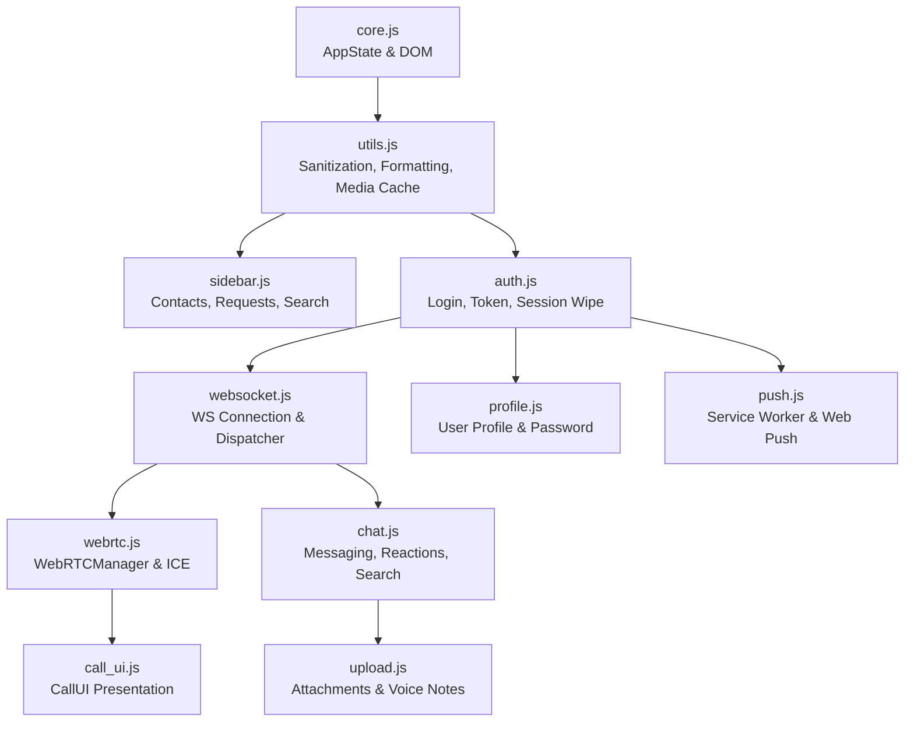
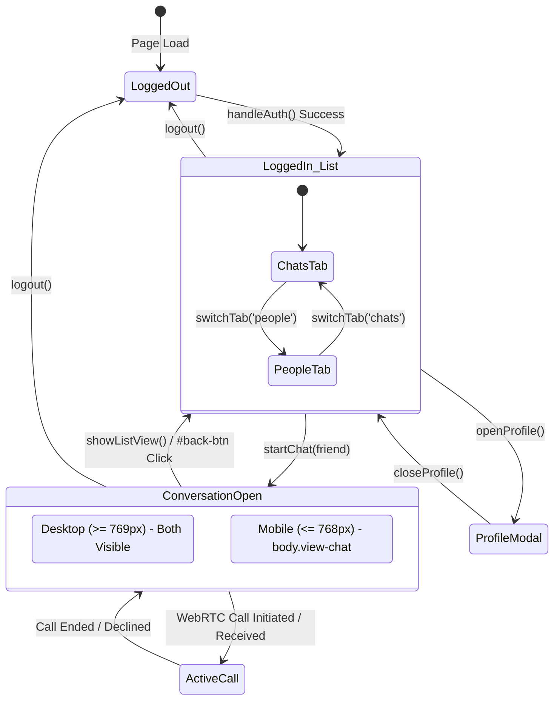
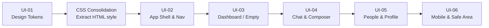

# ChatSpic Frontend Architecture Audit Report (AUDIT-02)

**Document ID:** `CHATSPIC_FRONTEND_ARCHITECTURE_AUDIT_V1.md`  
**Audit Date:** November 23, 2026  
**Auditor:** Antigravity Agentic AI Assistant (DeepMind)  
**Target Repository:** ChatSpic (`d:\ChatApp2`)  
**Current Git Branch:** `feature/ui-redesign-v1`  
**Execution Type:** Read-Only Codebase Audit — No Code Modifications  

---

## 1. Executive Summary

This architecture verification audit was conducted on the live ChatSpic repository open in Antigravity to establish a verified technical baseline prior to executing the upcoming UI redesign.

ChatSpic is a real-time, browser-based private messaging and WebRTC voice/video calling application. The backend is implemented in **Python 3.11 with FastAPI (0.127.0)**, **SQLAlchemy (2.0.45)**, **SQLite (`chat.db`)**, **Alembic (1.20.0)**, **WebSockets (15.0.1)**, and **PyWebPush (2.5.0)**. The frontend is a **Single Page Application (SPA)** built with **pure Vanilla HTML5, CSS3, and JavaScript** without any UI framework (no React, Vue, Angular, Svelte) or bundling system (no Webpack, Vite, Rollup, Tailwind).

### Key Audit Findings

1. **Clean Test and Runtime Baseline:** The repository has an active test suite of **467 automated tests** (covering auth, API, security, uploads, rich media, WebRTC signaling, WebSockets, and database migrations). All **467 tests pass cleanly (100% pass rate in 126.7s)**.
2. **Critical Architectural Style Split:** Important UI styling is fragmented between external stylesheets and embedded `<style>` tags in `static/index.html`. While rich media components (media preview trays, voice messaging, file cards, YouTube embeds, call screens) reside in `static/css/components.css` (1,675 lines), the core chat messaging system (message bubbles, timestamps, status ticks, action menus, reply banners, edit banner, in-chat search, input composer) and the entire mobile slide-transition engine (`body.view-list` / `body.view-chat`) are embedded in `<style>` inside `static/index.html` (lines 10–231).
3. **Strict Mobile Contract (`body.view-list` & `body.view-chat`):** Mobile responsiveness (`max-width: 768px`) relies on off-canvas CSS transforms driven by these two classes toggled on `document.body`. Modifying or removing these classes will immediately break mobile navigation.
4. **Fragile DOM Coupling in Calling and Media Systems:** The calling system (`static/js/call_ui.js` and `static/js/webrtc.js`) and upload/voice recorder (`static/js/upload.js`) query over 45 hardcoded DOM element IDs. Renaming or dropping these IDs during UI redesign will catastrophically break calling and attachments.
5. **Session Lifecycle In-Memory:** Authentication tokens (JWT) are held in memory (`token = data.access_token`). No localStorage or sessionStorage is used for tokens; page refresh unloads the session and returns the user to the login screen.
6. **Redesign Safety Verdict:** The proposed sequence (`UI-01` through `UI-06`) is **safe and feasible**, provided that `UI-01` and `UI-02` consolidate the embedded CSS into the design system while strictly preserving all existing DOM element IDs, function interfaces, and the mobile `body.view-*` contract.

---

## 2. Repository Baseline

### 2.1 Git Status & Branch

- **Current Branch:** `feature/ui-redesign-v1` (verified via `git branch --show-current`).
- **Working Tree Status:** Clean (`nothing to commit, working tree clean`) prior to report creation.
- **Repository Path:** `d:\ChatApp2`

### 2.2 Repository Directory Boundaries

```
d:\ChatApp2/
├── .agents/
│   └── rules/
│       └── chatspic-development.md    # User development rules
├── alembic/                           # Database schema migration scripts (6 versions)
│   ├── env.py
│   └── versions/
├── backend/                           # Server-side application logic (FastAPI)
│   ├── api/                           # HTTP route handlers (auth, chat, friends, profile, call, upload, push)
│   ├── core/                          # Security, config, logging, error handlers
│   ├── db/                            # SQLAlchemy models (models.py) and session management (database.py)
│   ├── realtime/                      # WebSocket endpoints and connection manager
│   ├── schemas/                       # Pydantic validation schemas
│   └── services/                      # Business logic layer (chat, auth, friend, upload, call, push, backup)
├── chatapp/                           # Local Python 3.11 virtual environment (Scripts, Lib/site-packages)
├── docs/                              # Project documentation
├── static/                            # Frontend assets served by FastAPI StaticFiles
│   ├── css/                           # Stylesheets (variables.css, base.css, layout.css, components.css)
│   ├── js/                            # JavaScript modules (11 modules)
│   ├── index.html                     # Application entry point and shell
│   └── sw.js                          # Web Push Service Worker
├── tests/                             # Automated test suite (23 test modules inheriting BaseTestCase)
├── uploads/                           # User-uploaded files (images, audio, video, docs, avatars)
├── alembic.ini                        # Alembic migration configuration
├── ARCHITECTURE.md                    # Living project architectural specification
├── chat.db                            # Active SQLite database file
├── main.py                            # FastAPI entry point, middleware, routes, and static mounts
└── requirements.txt                   # Pinned Python package dependencies
```

### 2.3 Frameworks and Libraries Used

| Component | Technology | Version | Purpose |
|---|---|---|---|
| **Backend Framework** | FastAPI | 0.127.0 | REST API and WebSocket routing |
| **ASGI Server** | Uvicorn | 0.40.0 | High-performance HTTP/WebSocket server |
| **ORM** | SQLAlchemy | 2.0.45 | Database modeling, queries, relationships |
| **Migrations** | Alembic | 1.20.0 | Versioned schema migrations |
| **Database** | SQLite | 3 | Embedded relational database (`chat.db`) |
| **Authentication** | python-jose / passlib / bcrypt | 3.5.0 / 1.7.4 / 3.2.2 | JWT signing/verification, bcrypt password hashing |
| **Push Notifications** | pywebpush | 2.5.0 | VAPID Web Push protocol |
| **WebSocket** | websockets | 15.0.1 | Full-duplex real-time protocol |
| **Frontend UI Framework** | **None (Vanilla JS/DOM)** | ES2020+ | Direct DOM manipulation |
| **Frontend Styling** | **None (Pure CSS3)** | Modern CSS | CSS custom properties, Flexbox, media queries |
| **External CDN Library** | Emoji Button | 4.6.4 | Joe Attardi's `@joeattardi/emoji-button` via jsDelivr CDN |
| **External Avatar API** | DiceBear SVG API | 7.x | Procedural SVG avatar fallbacks (`api.dicebear.com`) |

### 2.4 Build System & Package Manager

- **Frontend:** No Node.js build system, npm, yarn, or pnpm exists. There is no `package.json`, `webpack.config.js`, `vite.config.js`, or `tailwind.config.js`. All frontend code is served directly as static files.
- **Backend:** Managed with Python standard tools using `requirements.txt` inside a virtual environment located in `./chatapp`.

### 2.5 Server Architecture & Entry Points

- **Backend Entry Point:** [`main.py`](file:///d:/ChatApp2/main.py#L1-L114). Initializes FastAPI app, applies `SecurityHeadersMiddleware`, CORS, mounts `/static` via `StaticFiles(directory=settings.STATIC_DIR)`, registers `/uploads` via `register_uploads(app)`, and routes `/` to return `static/index.html` via `FileResponse`.
- **Frontend Entry Point:** [`static/index.html`](file:///d:/ChatApp2/static/index.html#L1-L732). Single HTML shell containing authentication overlays, main layout panels, calling screens, and modal dialogs.
- **Service Worker:** [`static/sw.js`](file:///d:/ChatApp2/static/sw.js#L1-L89), served from root scope `/sw.js` via dedicated FastAPI route [`main.py:67-79`](file:///d:/ChatApp2/main.py#L67-L79).

### 2.6 Test Baseline Verification

- **Test Suite Location:** [`tests/`](file:///d:/ChatApp2/tests) (23 test files).
- **Execution Command:** `chatapp\Scripts\python.exe -m unittest discover tests`
- **Verification Result:** **Ran 467 tests in 126.683s — OK (0 failures, 0 errors)**. All test suites pass with database isolation via in-memory SQLite and `PRAGMA foreign_keys=ON`.

---

## 3. Frontend Architecture

### 3.1 Architectural Paradigm

The frontend is a **Client-Side Rendered Single Page Application (SPA)** written in Vanilla JavaScript and procedural DOM manipulation without a virtual DOM or reactive framework.

1. **Page Load:** The browser loads `static/index.html`, parses the embedded `<style>` and linked CSS files, and downloads the 11 script tags in sequential order.
2. **Initial State:** On load, the `#login-screen` overlay is visible (`display: flex`) and `#app-container` is hidden (`display: none`).
3. **Authentication:** Submitting login credentials (`handleAuth()`) retrieves a JWT `access_token` stored in the in-memory variable `token`. The `#login-screen` is hidden and `#app-container` is displayed.
4. **Real-time Lifecycle:** Upon login, `connectWebSocket()` initiates a WebSocket connection (`/ws?token=...`). The client joins user-specific and contact rooms, handles typing indicators, presence events, WebRTC call invites, message updates, deletions, and read receipts.
5. **DOM Updates:** Handled by direct DOM manipulation (`document.createElement`, `element.appendChild`, `innerHTML = ""`, `classList.add/remove`).

### 3.2 Frontend File Inventory

| Category | File Path | Size (Bytes) | Primary Responsibility |
|---|---|---|---|
| **HTML** | [`static/index.html`](file:///d:/ChatApp2/static/index.html) | 43,314 | Application shell, overlays, modals, calling screens, scripts |
| **Service Worker**| [`static/sw.js`](file:///d:/ChatApp2/static/sw.js) | 2,780 | Push event listener, notification clicks, window focus/navigation |
| **CSS** | [`static/css/variables.css`](file:///d:/ChatApp2/static/css/variables.css) | 539 | CSS custom properties (colors, spacing, radius) |
| **CSS** | [`static/css/base.css`](file:///d:/ChatApp2/static/css/base.css) | 245 | Reset, body base styles, box-sizing |
| **CSS** | [`static/css/layout.css`](file:///d:/ChatApp2/static/css/layout.css) | 927 | Layout structure (sidebar, chat-area, headers) |
| **CSS** | [`static/css/components.css`](file:///d:/ChatApp2/static/css/components.css) | 37,648 | Components, calling UI, rich media, voice notes, YouTube embeds |
| **JavaScript** | [`static/js/core.js`](file:///d:/ChatApp2/static/js/core.js) | 473 | Global `AppState` and `DOM` cache placeholders |
| **JavaScript** | [`static/js/utils.js`](file:///d:/ChatApp2/static/js/utils.js) | 10,300 | Sanitization, toast, date formatting, secure blob cache, YouTube parsing |
| **JavaScript** | [`static/js/auth.js`](file:///d:/ChatApp2/static/js/auth.js) | 5,381 | Login, registration, logout, security memory wipe |
| **JavaScript** | [`static/js/sidebar.js`](file:///d:/ChatApp2/static/js/sidebar.js) | 11,335 | Chats/People tabs, friend list, contact search, friend requests |
| **JavaScript** | [`static/js/websocket.js`](file:///d:/ChatApp2/static/js/websocket.js) | 7,135 | WS lifecycle, reconnect timer, message dispatcher |
| **JavaScript** | [`static/js/chat.js`](file:///d:/ChatApp2/static/js/chat.js) | 65,217 | Conversation loading, messaging, reactions, replies, search, actions |
| **JavaScript** | [`static/js/upload.js`](file:///d:/ChatApp2/static/js/upload.js) | 34,000 | Attachments, upload preview tray, voice recording and preview |
| **JavaScript** | [`static/js/profile.js`](file:///d:/ChatApp2/static/js/profile.js) | 6,472 | Profile modal, display name, about, avatar upload, password change |
| **JavaScript** | [`static/js/call_ui.js`](file:///d:/ChatApp2/static/js/call_ui.js) | 37,003 | Call presentation, modals, in-call screen, minimized bar, ringtones |
| **JavaScript** | [`static/js/webrtc.js`](file:///d:/ChatApp2/static/js/webrtc.js) | 37,060 | WebRTC connection, ICE servers, media acquisition, signaling |
| **JavaScript** | [`static/js/push.js`](file:///d:/ChatApp2/static/js/push.js) | 8,913 | Web Push subscription, permission banner, visibility tracking |

---

## 4. HTML Structure

[`static/index.html`](file:///d:/ChatApp2/static/index.html) is organized into hierarchical functional zones:

```
<body>
├── #toast-container                           (Floating notification toasts)
├── #login-screen.overlay                      (Login & Registration card)
├── #profile-screen.overlay                    (Profile editor & Password change)
├── #app-container.view-list                   (Main Application Split View)
│   ├── .sidebar                               (Navigation & Lists)
│   │   ├── .sidebar-header                    (Brand header, profile/logout buttons, tabs, user search)
│   │   └── #list-area.list-area               (Dynamic contact / chat list container)
│   └── .chat-area                             (Conversation Area)
│       ├── .chat-header                       (Back btn, contact title, status, voice/video call buttons)
│       ├── #chat-search-container             (In-conversation message search input & clear btn)
│       ├── #chat-search-results               (Dropdown list of search matches)
│       ├── #messages.messages                 (Scrollable chat message list or empty state)
│       ├── #typing-indicator                  (Inline indicator banner)
│       ├── #edit-mode-banner                  (Message editing banner with cancel btn)
│       ├── #reply-mode-banner                 (Message reply banner with quote & cancel btn)
│       ├── #media-preview-tray                (Attachment preview before upload: img/video/doc)
│       ├── #voice-record-bar                  (Active voice recording bar with timer & stop/cancel)
│       ├── #voice-preview-tray                (Voice playback preview with seekbar & send/discard)
│       └── .input-area                        (Composer: hidden file inputs, emoji btn, text input, attach/camera/voice/send btns)
├── #outgoing-call-modal.call-modal-overlay    (Outgoing call ringing modal)
├── #incoming-call-modal.call-modal-overlay    (Incoming call ringing modal with accept/decline)
├── #call-fallback-modal.call-modal-overlay    (Camera failure prompt offering voice fallback)
├── #call-screen.call-screen                   (Full-screen active voice/video call interface)
│   ├── .call-screen-header                    (Peer name, call timer, reconnecting badge, minimize/fullscreen btns)
│   ├── .call-media-viewport                   (Video streams / Voice avatar)
│   │   ├── #call-voice-view                   (Voice avatar container)
│   │   └── #call-video-view                   (Remote video + local PiP video)
│   └── .call-controls-bar                     (Mute, camera, flip-camera, PiP, speaker, end-call btns)
├── #call-minimized-bar.call-minimized-bar     (Floating bottom-right bar when call is minimized to chat)
├── #call-remote-audio                         (Hidden audio element for remote WebRTC audio)
└── #image-lightbox-modal.lightbox-overlay     (Fullscreen image zoom view)
```

### Critical Observation on Duplicate DOM IDs

- **`#typing-indicator` exists twice in `static/index.html`:**
  1. [`index.html:325`](file:///d:/ChatApp2/static/index.html#L325): `<span id="typing-indicator" style="font-size: 11px; color: #007bff; font-weight: bold; display: none;">typing...</span>` (Inside `.chat-header`).
  2. [`index.html:363`](file:///d:/ChatApp2/static/index.html#L363): `<div id="typing-indicator" style="display: none; color: #0084ff; font-size: 12px; padding: 5px 15px; font-style: italic;">Someone is typing...</div>` (Above `.messages`).
  
  In [`websocket.js:101`](file:///d:/ChatApp2/static/js/websocket.js#L101), the code explicitly accommodates this duplication via `document.querySelectorAll("#typing-indicator, .typing-indicator")`.

---

## 5. CSS Architecture

### 5.1 Stylesheet Load Order

In [`static/index.html:6-10`](file:///d:/ChatApp2/static/index.html#L6-L10), stylesheets are loaded in the following order:

1. [`/static/css/variables.css`](file:///d:/ChatApp2/static/css/variables.css) — Custom properties definition (`:root`).
2. [`/static/css/base.css`](file:///d:/ChatApp2/static/css/base.css) — CSS reset and body defaults.
3. [`/static/css/layout.css`](file:///d:/ChatApp2/static/css/layout.css) — Top-level grid/flex container layout.
4. [`/static/css/components.css`](file:///d:/ChatApp2/static/css/components.css) — Modular component styles.
5. **Embedded `<style>` tag in `static/index.html:10-231`** — Overrides external CSS and defines core messaging and responsive rules.

### 5.2 The External vs Embedded CSS Split

The audit uncovered a significant structural split in CSS responsibilities:

| UI System | Primary CSS Location | Lines | Key Selectors |
|---|---|---|---|
| **Design Tokens** | `static/css/variables.css` | 1–24 | `:root` |
| **Global Reset** | `static/css/base.css` | 1–3 | `body`, `*` |
| **Layout Shell** | `static/css/layout.css` | 1–27 | `#app-container`, `.sidebar`, `.chat-area` |
| **Calling System** | `static/css/components.css` | 60–615 | `.call-modal-*`, `.call-screen`, `.call-controls-bar`, `.call-minimized-bar` |
| **Rich Media Attachments** | `static/css/components.css` | 616–1060 | `.media-preview-tray`, `.lightbox-*`, `.attach-menu`, `.msg-file-card` |
| **Voice Messaging** | `static/css/components.css` | 1061–1363 | `.voice-record-bar`, `.voice-preview-tray`, `.msg-voice-card` |
| **Push Banner** | `static/css/components.css` | 1364–1447 | `.push-permission-banner`, `.push-prompt-*` |
| **YouTube Embeds** | `static/css/components.css` | 1448–1675 | `.msg-youtube-card`, `.msg-youtube-iframe`, `.msg-youtube-play-btn` |
| **Core Message Bubbles** | **`static/index.html` (embedded)** | 37–64 | `.messages`, `.msg`, `.msg.me`, `.msg.friend`, `.msg.selected`, `.msg-time`, `.msg-status`, `.message-action-*` |
| **Reactions System** | **`static/index.html` (embedded)** | 65–127 | `.reaction-picker`, `.reaction-chip`, `.msg-reactions` |
| **In-Chat Search** | **`static/index.html` (embedded)** | 128–140 | `.chat-search-container`, `.chat-search-input`, `.chat-search-results` |
| **Reply / Edit Banners** | **`static/index.html` (embedded)** | 141–158 | `.edit-mode-banner`, `.reply-mode-banner`, `.msg-reply-preview` |
| **Composer Input Area** | **`static/index.html` (embedded)** | 159–163 | `.input-area`, `.input-area input`, `#send-btn` |
| **Mobile Slide Navigation** | **`static/index.html` (embedded)** | 169–192 | `@media (max-width: 768px)`, `body.view-list`, `body.view-chat`, `#back-btn` |
| **Typing Indicator** | **`static/index.html` (embedded)** | 194–210 | `.typing-indicator` (Floating glassmorphic pill) |
| **Mobile Header Override** | **`static/index.html` (embedded)** | 213–230 | `@media (max-width: 768px) { .chat-header { ... !important } }` |

### 5.3 CSS Design Tokens & Variable Usage

[`static/css/variables.css:1-24`](file:///d:/ChatApp2/static/css/variables.css#L1-L24) defines 17 design tokens:
- **Colors:** `--color-bg: #121212`, `--color-surface: #1e1e1e`, `--color-panel: #0f0f0f`, `--color-muted: #888`, `--color-text: #e0e0e0`, `--color-text-strong: #ffffff`, `--color-accent: #0084ff`, `--color-success: #2ecc71`, `--color-danger: #d9534f`, `--color-border: #2a2a2a`.
- **Spacing:** `--spacing-xs: 5px`, `--spacing-sm: 10px`, `--spacing: 15px`, `--spacing-md: 20px`, `--spacing-lg: 30px`.
- **Border Radii:** `--radius: 16px`, `--radius-sm: 8px`.

**Finding:** These variables are largely bypassed. In `components.css` and `static/index.html`, raw hex codes (`#1e1e1e`, `#2a2a2a`, `#0084ff`, `#28a745`, `#d9534f`) and explicit pixel values are hardcoded across 95% of selectors. The token system is therefore an incomplete foundation that must be consolidated during `UI-01`.

### 5.4 Theme Implementation

- **Dark Theme:** Hardcoded as the default and only theme throughout the application.
- **Light Theme:** **Non-existent**. There is no `prefers-color-scheme` media query, no `[data-theme="light"]` attribute, and no light-mode token definitions. Introducing a light theme would require full decoupling of hardcoded hex values into token variables.

### 5.5 Conflicting and Duplicate Selectors

1. **`.icon-btn` dimensions conflict:**
   - [`static/css/components.css:32-44`](file:///d:/ChatApp2/static/css/components.css#L32-L44): `width: 38px; height: 38px; font-size: 20px;`
   - [`static/index.html:181`](file:///d:/ChatApp2/static/index.html#L181): Inside `@media (max-width: 768px)`, `.icon-btn { width: 35px; height: 35px; font-size: 18px; }`
2. **Conflicting mobile header rules in embedded CSS:**
   - [`static/index.html:185`](file:///d:/ChatApp2/static/index.html#L185): `.chat-header { padding-top: 50px !important; height: 90px !important; align-items: flex-end !important; padding-bottom: 10px !important; }`
   - [`static/index.html:214-221`](file:///d:/ChatApp2/static/index.html#L214-L221): A second `@media (max-width: 768px)` block immediately follows with: `.chat-header { align-items: center !important; justify-content: flex-start !important; padding-bottom: 10px !important; padding-left: 15px !important; gap: 15px !important; }` to counteract the first rule.
3. **Heavy use of `!important`:**
   Found on lines 184, 185, 188, 216, 217, 218, 219, 220 in `static/index.html`, and lines 1643–1652 in `components.css` (YouTube fullscreen overrides).

---

## 6. JavaScript Module Responsibilities

The frontend codebase is split across 11 JavaScript modules loaded in strict order before the closing `</body>` tag.



### 6.1 Detailed Module Audit

#### 1. `static/js/core.js` (Lines 1–21)
- **Role:** Declares global state container `AppState` (`token`, `currentUser`, `currentFriend`, `currentTab`, `ws`, `reconnectTimer`, `presenceRefreshTimer`, `isRegisterMode`) and `DOM` cache dictionary.
- **Finding:** While `AppState` exists, several subsequent modules write directly to window-level global variables (`token`, `currentUser`, `currentFriend`, `currentTab`) declared in `static/index.html:668-676`. `AppState` acts as a secondary reference rather than a strict single source of truth.

#### 2. `static/js/utils.js` (Lines 1–309)
- **Role:** Common utilities.
- **Key Functions:**
  - `showToast(msg, type)` (Lines 1–14): Toast notification generator with slide-in animation.
  - `formatLastSeen(isoStr)` (Lines 16–25): Relative timestamp generator ("Online", "5m ago", "2h ago", "3d ago").
  - `formatMessageTimestamp(timestamp)` (Lines 27–44): Absolute 12-hour timestamp formatting (`DD/MM/YYYY HH:MM:SS AM/PM`).
  - `escapeHtml(str)` (Lines 46–54): XSS prevention via character entity encoding.
  - `sanitizeMediaUrl(url)` (Lines 56–88): Strict URL validation; rejects `javascript:`, `data:`, `vbscript:`, `//`.
  - `fetchSecureMediaBlobUrl(url)` (Lines 121–189): Authenticated media fetcher attaching `Authorization: Bearer <token>` and converting binary response to local Object URLs with in-memory caching (`secureMediaCache`).
  - `parseYouTubeVideo(text)` / `parseYouTubeTimestamp(param)` (Lines 191–305): Validates YouTube URLs against allowed hostnames (`youtube.com`, `youtu.be`, `youtube-nocookie.com`), extracts 11-char video IDs, timestamps, and Shorts status.

#### 3. `static/js/auth.js` (Lines 1–131)
- **Role:** User authentication and session management.
- **Key Functions:**
  - `toggleMode()` (Lines 1–6): Switches form between Login and Register modes.
  - `handleAuth()` (Lines 8–58): Submits `/login` or `/register`. On login success: stores `token`, unhides `#app-container`, connects WebSocket, starts presence polling, initializes push notifications, and handles deep-link conversation navigation (`pendingChatNavigation`).
  - `logout()` (Lines 60–131): Comprehensive security cleanup. Closes WebRTC call, disconnects WebSocket, unregisters push, revokes media Object URLs (`revokeSecureMediaCache()`), clears HTML elements (`list-area`, `messages`), resets inputs, and zeroes all session variables.

#### 4. `static/js/sidebar.js` (Lines 1–298)
- **Role:** Contact list, friend requests, user search, unread badge management.
- **Key Functions:**
  - `switchTab(tabName)` (Lines 1–18): Toggles between `'chats'` and `'people'` tabs; toggles `#search-container` visibility.
  - `loadSidebar()` (Lines 20–120): Concurrently fetches `/friends/requests`, `/friends`, and `/conversations`. Merges unread message counts into friend objects, updates `window.cachedFriends`, and renders cards.
  - `handleSearch(e)` (Lines 122–209): Calls `/search?query=...` and renders user directory search results with Add Friend / Pending / Friend action buttons.
  - `renderFriendItem(container, friend)` (Lines 222–286): Builds contact card DOM nodes with avatar (local uploaded or DiceBear SVG), online presence indicator dot, last seen text, and unread count badge.
  - `addFriend(username)` / `acceptRequest(requestId)` (Lines 288–298): Manages social graph state.

#### 5. `static/js/websocket.js` (Lines 1–198)
- **Role:** Real-time communications lifecycle and message demultiplexing.
- **Key Functions:**
  - `connectWebSocket()` (Lines 1–34): Opens WebSocket connection to `/ws?token=...` with auto-reconnection backoff (3s interval).
  - `disconnectWebSocket()` (Lines 36–49): Explicit tear-down on logout.
  - `sendSocketPayload(payload)` (Lines 51–59): Queues or transmits JSON messages over the active socket.
  - `handleSocketMessage(event)` (Lines 61–160): Dispatcher routing incoming messages by `type`:
    - Calling/WebRTC: `call.invite`, `call.accept`, `call.reject`, `call.cancel`, `call.end`, `webrtc.offer`, `webrtc.answer`, `webrtc.ice_candidate` → forwarded to `WebRTCManager`.
    - Messaging: `chat` → calls `addMessage()`.
    - Message Updates: `message_updated`, `message_deleted` → updates existing DOM message elements.
    - Status/Receipts: `message_status`, `messages_read` → updates delivery and blue read-receipt checkmarks.
    - Reactions: `reaction_update` → updates message reaction chips.
    - Typing: `typing` → calls `showTyping()`.
  - `startPresenceRefresh()` / `stopPresenceRefresh()` (Lines 162–184): 15-second polling interval refreshing sidebar friend presence.

#### 6. `static/js/chat.js` (Lines 1–1,749)
- **Role:** Core conversation view controller.
- **Key Functions:**
  - `startChat(friend, element)` (Lines 274–335): Selects an active conversation. Cancels edit/reply modes, updates header title/status, wipes previous messages, enables inputs, joins room over WebSocket, and on mobile viewport (<= 768px) switches classes to `body.view-chat`.
  - `send()` (Lines 381–416): Transmits new text message or submits edited message text.
  - Message editing: `enterMessageEditMode()`, `cancelMessageEdit()`, `updateMessageContent()`.
  - Message replies: `enterReplyMode()`, `cancelReplyMode()`, `buildReplyPreviewElement()`.
  - Message deletion: `applyDeletedState()`, `updateDeletedMessage()`.
  - Reactions: `openReactionPicker()`, `closeReactionPicker()`, `renderMessageReactions()`, `updateMessageReactions()`.
  - Search within conversation: `searchConversationMessages()`, `renderConversationSearchResults()`, `jumpToMessageById()`.
  - Lightbox: `openImageLightbox(src)`, `closeImageLightbox()`.
  - YouTube embeds: `renderYouTubePreviewCard()`, `toggleCardFullscreen()`.
  - `addMessage(...)` (Lines 1265–1748): Primary message renderer constructing DOM bubbles with sender name, reply preview, authenticated media (image, video, document file card, voice card, YouTube embed), message text, timestamp, delivery ticks, action menu trigger, and reactions.

#### 7. `static/js/upload.js` (Lines 1–899)
- **Role:** Media attachments, upload pipeline, and audio recording.
- **Key Functions:**
  - Attachment pickers: `openGalleryPicker()`, `openDocumentPicker()`, `openCameraPicker()`, `toggleAttachMenu()`.
  - Preview & Upload: `handleFileSelect()`, `displayMediaPreview()`, `startUpload()`, `retryUpload()`, `cancelUpload()` (using `AbortController` and `XMLHttpRequest` progress events).
  - Voice Recording: `startVoiceRecording()`, `beginMediaRecording()` (using `MediaRecorder` with `audio/webm;codecs=opus` or `audio/ogg`), `stopVoiceRecording()`, `cancelVoiceRecording()`.
  - Voice Preview & Upload: `displayVoicePreview()`, `toggleVoicePreviewPlayback()`, `seekVoicePreview()`, `startVoiceUpload()`.

#### 8. `static/js/profile.js` (Lines 1–191)
- **Role:** Profile settings modal and password changes.
- **Key Functions:**
  - `openProfile()` / `closeProfile()` (Lines 3–50): Fetches `/profile/` and populates form fields.
  - `saveProfile()` (Lines 52–78): Submits updated `display_name` and `about`.
  - `handleProfilePicChange()` (Lines 80–132): Uploads new avatar via `/upload` and updates profile via `PUT /profile/picture`.
  - `handleChangePassword()` (Lines 134–190): Validates passwords and submits to `/change-password`.

#### 9. `static/js/webrtc.js` (Lines 1–1,095)
- **Role:** Headless WebRTC connection engine and signaling protocol handler.
- **Export:** Exposes `window.WebRTCManager` (Lines 1036–1095).
- **Key Functions:**
  - `fetchIceServers()`: Queries `/call/config` for STUN/TURN servers.
  - `acquireLocalMedia(callType)`: Obtains user media via `navigator.mediaDevices.getUserMedia`.
  - `startCallerFlow()`, `acceptCall()`, `rejectCall()`, `cancelCall()`, `endCall()`.
  - Track & Connection Management: `createPeerConnection()`, ICE trickle candidate handling, ICE restart, device mute/camera toggling, and video-to-voice fallback.

#### 10. `static/js/call_ui.js` (Lines 1–970)
- **Role:** Presentation and user interaction layer for calling.
- **Export:** Exposes `window.CallUI` (Lines 955–970).
- **Key Functions:**
  - Subscribes to `WebRTCManager` events (`onCallStateChange`, `onCallInvite`, `onCallReject`, `onCallCancel`, `onCallEnd`, `onLocalStream`, `onRemoteStream`, `onCallError`, `onVoiceFallbackAvailable`).
  - Manages modal visibility (`#outgoing-call-modal`, `#incoming-call-modal`, `#call-fallback-modal`).
  - Controls `#call-screen`, `#call-minimized-bar`, duration timers, and synthesized Web Audio API ringtones.

#### 11. `static/js/push.js` (Lines 1–276)
- **Role:** Web Push notifications and background conversation navigation.
- **Key Functions:**
  - `initPushNotifications()`: Registers `/sw.js`, checks permissions, displays permission banner (`#push-permission-prompt`).
  - `subscribeToPush(vapidPublicKey)`: Subscribes with `pushManager` and registers subscription on `/push/subscribe`.
  - `navigateToConversation(username)`: Opens specific conversation when user clicks a notification.
  - Page visibility listener: Reports active tab status to server over WebSocket.

---

## 7. Application State and Navigation

### 7.1 State Storage and Persistence

- **Authentication State:** In-memory only. `token` and `currentUser` are stored in global JavaScript scope.
  - **Verified Fact:** There is **no persistent session storage**. If the user reloads the browser, all credentials are lost and the user must log in again.
- **Contact and Friend Cache:** Cached in `window.cachedFriends` (array of friend objects) by `sidebar.js:55`.
- **Active Conversation:** Held in global variable `currentFriend` (username string).
- **Active Navigation Tab:** Held in `currentTab` (`'chats'` or `'people'`).
- **Media Object URLs:** Tracked in `secureMediaCache` (`Map<string, string>`) in `utils.js:92` to avoid duplicate binary downloads of images and attachments during a single session.
- **LocalStorage Usage:** The only item saved to `localStorage` is `'push_prompt_dismissed': 'true'` in `push.js:108`.

### 7.2 Desktop vs Mobile Navigation State Machine

The application state machine governs screen visibility through body classes and inline display styles:



---

## 8. Responsive Architecture

### 8.1 Breakpoints Actually Used

The live repository contains exactly one responsive boundary:

- **Mobile Viewport:** `@media (max-width: 768px)`
- **Desktop Viewport:** `@media (min-width: 769px)` (Used solely to enforce `#back-btn { display: none; }` in `static/index.html:191`).

No tablet, intermediate (e.g. 1024px), or ultra-wide breakpoints exist.

### 8.2 The Mobile Transition Contract (`body.view-list` & `body.view-chat`)

Mobile navigation depends on a strict two-class contract enforced in CSS and manipulated via JavaScript:

```css
/* static/index.html:169-180 */
@media (max-width: 768px) {
    .sidebar { 
        width: 100%; height: 100%; position: absolute; top: 0; left: 0; 
        transition: transform 0.3s ease; 
    }
    .chat-area { 
        width: 100%; height: 100dvh; bottom: 0; position: absolute; top: 0; left: 0; 
    }

    /* List View State */
    body.view-list .sidebar { transform: translateX(0); z-index: 50; }
    body.view-list .chat-area { z-index: 0; }

    /* Chat View State */
    body.view-chat .sidebar { transform: translateX(-100%); }
    body.view-chat .chat-area { z-index: 50; }
}
```

#### JavaScript Handlers
- **Entering Chat:** [`static/js/chat.js:330-334`](file:///d:/ChatApp2/static/js/chat.js#L330-L334) and [`static/index.html:680-683`](file:///d:/ChatApp2/static/index.html#L680-L683):
  ```javascript
  if (window.innerWidth <= 768) {
      document.body.classList.add("view-chat");
      document.body.classList.remove("view-list");
  }
  ```
- **Returning to List:** [`static/index.html:685-692`](file:///d:/ChatApp2/static/index.html#L685-L692):
  ```javascript
  function showListView() {
      document.body.classList.add("view-list");
      document.body.classList.remove("view-chat");
      if (typeof CallUI !== "undefined" && typeof CallUI.onChatDeselected === "function") {
          CallUI.onChatDeselected();
      }
  }
  ```
  Bound directly to `<button id="back-btn" onclick="showListView()">&#8592;</button>`.

> [!CRITICAL]
> **Contract Preservation Warning:** Any UI redesign that changes `body.view-list`, `body.view-chat`, `#back-btn`, or `showListView()` without an exact drop-in replacement will immediately break mobile navigation, stranding users inside either the list or the chat view with no way to navigate back.

### 8.3 Viewport Units & Keyboard Handling

- **`100dvh` vs `100vh`:** In `static/index.html:172`, `.chat-area` on mobile uses `height: 100dvh`. This correctly handles dynamic browser address bars in modern mobile browsers. However, `body` in `static/css/base.css:2` is set to `height: 100vh; overflow: hidden;`.
- **Virtual Keyboard Risk:** There is no `interactive-widget=resizes-content` viewport meta tag (current viewport meta tag in `static/index.html:5` is `width=device-width, initial-scale=1.0, maximum-scale=1.0, user-scalable=no`). On iOS Safari and Chrome Android, virtual keyboard opening can obscure the message input area because the composer relies on `position: relative` inside a flex container rather than dynamic bottom-inset padding.

### 8.4 Safe-Area Inset Handling

In `static/index.html:184-185`:
```css
.sidebar-header { padding-top: 50px !important; }
.chat-header { padding-top: 50px !important; height: 90px !important; align-items: flex-end !important; padding-bottom: 10px !important; }
```
**Issue Identified:** The code uses a hardcoded `50px !important` top padding to clear device notches. It does **not** use the standard CSS `env(safe-area-inset-top)` or `viewport-fit=cover`. Consequently:
- Non-notch phones (standard rectangular Android displays) suffer an artificial 50px wasted top margin.
- Devices with larger Dynamic Island cutouts or in landscape orientation may still clip content.

---

## 9. Messaging and Media Features

### 9.1 Feature Implementation Matrix

| Messaging Feature | Status | Implementation Details | File / Line References |
|---|---|---|---|
| **Real-time Direct Chat** | **Fully Implemented** | Full-duplex WebSocket messaging via room join | `chat.js:381`, `websocket.js:97` |
| **Online Presence** | **Fully Implemented** | Server-reported `is_online` & `last_seen` timestamp | `sidebar.js:233`, `chat.js:295` |
| **Message Delivery Ticks** | **Fully Implemented** | Single tick (`✓`), double tick (`✓✓`), blue ticks for read | `chat.js:884-905`, `index.html:49-52` |
| **Read Receipts** | **Fully Implemented** | WebSocket `messages_read` updates status and color | `websocket.js:146`, `chat.js:920` |
| **Typing Indicator** | **Fully Implemented** | 3s debounce over WebSocket; renders in header & composer | `chat.js:337-378`, `index.html:194` |
| **Message Replies** | **Fully Implemented** | Self-referencing message FK (`reply_to_message_id`), reply banner, preview card | `chat.js:566-625`, `chat.js:927-952` |
| **Message Editing** | **Fully Implemented** | Edit banner, text replacement, `(edited)` label | `chat.js:418-435`, `chat.js:626-650` |
| **Message Deletion** | **Fully Implemented** | Tombstone text ("This message was deleted") | `chat.js:457-523` |
| **Emoji Reactions** | **Fully Implemented** | Reaction picker popover (6 emojis: 👍 ❤️ 😂 😮 😢 🙏), reaction chips on bubble | `chat.js:13-125`, `index.html:65-127` |
| **In-Conversation Search** | **Fully Implemented** | Client-side text filter on loaded conversation, jump-to-message, highlight flash | `chat.js:126-272`, `index.html:128-140` |
| **Image Messages** | **Fully Implemented** | Authenticated fetch via Object URL, aspect-ratio constraint, fullscreen lightbox | `chat.js:954-986`, `components.css:763-868` |
| **Video Messages** | **Fully Implemented** | MP4/WebM video element with native controls and authenticated source | `chat.js:1406-1440`, `components.css:784-795` |
| **File / Doc Cards** | **Fully Implemented** | Document icon, filename, formatted size, authenticated download link | `chat.js:1018-1084`, `components.css:947-1060` |
| **Voice Notes** | **Fully Implemented** | Audio recorder, duration timer, preview player, waveform progress bar | `upload.js:440-899`, `components.css:1061-1363` |
| **YouTube & Shorts Embed** | **Fully Implemented** | Regex video ID extraction, lazy-load thumbnail, sandbox iframe, fullscreen | `utils.js:191-305`, `chat.js:1127-1260` |
| **Attachment Menu** | **Fully Implemented** | Gallery, Document, Camera pickers via hidden `<input type="file">` | `upload.js:37-83`, `components.css:870-932` |
| **Web Push Notifications** | **Fully Implemented** | VAPID push manager, service worker background notifications, badge | `push.js:1-276`, `sw.js:1-89` |

All messaging features are active and functional—none are placeholders.

---

## 10. Voice and Video Calling Architecture (HIGH PRIORITY)

> [!IMPORTANT]
> The voice and video calling system is fully implemented and operational. It represents the highest technical complexity in the frontend and must be protected from regression during any styling or DOM changes.

### 10.1 Calling Architecture Diagram

```mermaid
sequenceDiagram
    autonumber
    actor Caller as Alice (Caller)
    participant CUI as CallUI (call_ui.js)
    participant WMC as WebRTCManager (webrtc.js)
    participant WS as WebSocket (websocket.js)
    participant SVR as FastAPI Server
    participant WMB as WebRTCManager (Callee)
    actor Callee as Bob (Callee)

    Note over Caller, Callee: 1. Outgoing Call Initialization
    Caller->>CUI: Clicks #btn-call-voice or #btn-call-video
    CUI->>WMC: initiateCall(peerUsername, callType)
    WMC->>WS: sendSocketPayload('call.invite')
    WS->>SVR: Forward call.invite to Callee
    CUI->>Caller: Show #outgoing-call-modal & Play synthesized ringback tone

    Note over Caller, Callee: 2. Callee Alerting & Acceptance
    SVR->>WS: Deliver call.invite
    WS->>WMB: handleCallInvite(inviteData)
    WMB->>Callee: Show #incoming-call-modal & Play synthesized ringtone
    Callee->>WMB: Clicks #btn-incoming-accept
    WMB->>WS: sendSocketPayload('call.accept')
    WS->>SVR->>WS: Deliver call.accept to Caller

    Note over Caller, Callee: 3. WebRTC PeerConnection & SDP Negotiation
    WS->>WMC: handleCallAccept(callId)
    WMC->>WMC: acquireLocalMedia() + fetchIceServers()
    WMC->>WMC: createPeerConnection() + createOffer()
    WMC->>WS: sendSocketPayload('webrtc.offer')
    WS->>SVR->>WS: Deliver webrtc.offer to Callee
    WS->>WMB: handleWebRTCOffer(sdp)
    WMB->>WMB: setRemoteDescription() + createAnswer()
    WMB->>WS: sendSocketPayload('webrtc.answer')
    WS->>SVR->>WS: Deliver webrtc.answer to Caller
    WMC->>WMC: setRemoteDescription(answer)

    Note over Caller, Callee: 4. ICE Candidates & Media Flow
    WMC-->>WMB: ICE Candidates exchanged via WS ('webrtc.ice_candidate')
    WMC-->>WMB: Direct P2P SRTP Media Stream Established
    CUI->>Caller: Show #call-screen (Media view & in-call controls)
```

### 10.2 Sensitive Calling Files and Critical Symbols

The calling implementation is encapsulated in three core files:

1. **Presentation & Controller:** [`static/js/call_ui.js`](file:///d:/ChatApp2/static/js/call_ui.js) (970 lines)
2. **WebRTC Engine & Signaling:** [`static/js/webrtc.js`](file:///d:/ChatApp2/static/js/webrtc.js) (1,095 lines)
3. **Signaling Backend:** [`backend/services/call_service.py`](file:///d:/ChatApp2/backend/services/call_service.py) & [`backend/realtime/websocket.py`](file:///d:/ChatApp2/backend/realtime/websocket.py)

#### Critical HTML DOM Elements Required by `call_ui.js`

If any of the following IDs are modified or removed from `static/index.html`, calling will fail:

- **Trigger Buttons:** `#btn-call-voice`, `#btn-call-video`, `#chat-header-actions`
- **Outgoing Modal:** `#outgoing-call-modal`, `#outgoing-callee-name`, `#outgoing-avatar-img`, `#outgoing-call-type`, `#outgoing-call-status`, `#btn-outgoing-cancel`
- **Incoming Modal:** `#incoming-call-modal`, `#incoming-caller-name`, `#incoming-avatar-img`, `#incoming-call-type`, `#btn-incoming-decline`, `#btn-incoming-accept`
- **Fallback Modal:** `#call-fallback-modal`, `#btn-fallback-cancel`, `#btn-fallback-voice`
- **Active Call Screen:** `#call-screen`, `#call-peer-name`, `#call-type-badge`, `#call-duration-timer`, `#call-reconnecting-badge`, `#btn-call-minimize`, `#btn-call-fullscreen`, `#call-voice-view`, `#call-voice-avatar`, `#call-video-view`, `#call-remote-video`, `#call-local-video`
- **In-Call Controls:** `#btn-call-mute`, `#btn-call-camera`, `#btn-call-switch-camera`, `#btn-call-pip`, `#btn-call-speaker`, `#btn-call-end`
- **Minimized Floating Bar:** `#call-minimized-bar`, `#call-minimized-avatar`, `#call-minimized-name`, `#minimized-duration`, `#btn-minimized-mute`, `#btn-minimized-expand`, `#btn-minimized-end`
- **Audio Element:** `#call-remote-audio`

---

## 11. Existing UI/UX Assessment

### 11.1 Confirmed Code Problems

1. **Embedded vs External CSS Fragmentation:** The core chat bubbles, edit/reply banners, input composer, and mobile navigation are stranded in an embedded `<style>` block in `static/index.html:10-231`.
2. **Hardcoded Safe-Area Padding:** Fixed `padding-top: 50px !important;` on `.sidebar-header` and `.chat-header` creates an unwanted 50px blank gap on non-notch mobile screens and desktop responsive simulations.
3. **Conflicting Mobile Header CSS:** Two separate `@media (max-width: 768px)` blocks in `static/index.html` conflict on `.chat-header` layout, requiring `align-items: center !important` to override `align-items: flex-end !important`.
4. **Duplicate DOM ID `#typing-indicator`:** Exists simultaneously at `index.html:325` and `index.html:363`.
5. **No Token Enforcement:** Less than 5% of styling uses the CSS variables defined in `variables.css`. Raw hex codes are duplicated across hundreds of lines.
6. **Inconsistent Button System:** Six different button design patterns exist simultaneously (`.box button`, `.action-btn`, `.icon-btn`, `.call-header-btn`, `.call-ctrl-btn`, inline-styled profile buttons).
7. **Accessibility Deficiencies:** Form inputs lack explicit `<label>` associations; 여러 buttons lack `aria-label`; contrast on `#888` text against `#1e1e1e` background is 3.5:1 (fails WCAG AA 4.5:1 minimum).

### 11.2 Potential Problems Requiring Runtime Verification

1. **Virtual Keyboard Layout Distortion on Mobile Devices:** `Requires runtime verification`. Setting `body { height: 100vh; overflow: hidden; }` combined with `100dvh` on `.chat-area` may cause input fields to be covered by virtual keyboards on mobile browsers without `interactive-widget=resizes-content`.
2. **WebRTC Speaker Selection Support (`setSinkId`):** `Requires runtime verification`. `#btn-call-speaker` relies on `navigator.mediaDevices.selectAudioOutput` and `HTMLMediaElement.prototype.setSinkId`, which are unsupported in iOS Safari and Firefox. The button is hidden by default (`display: none`), but device availability must be checked on target hardware.
3. **Picture-in-Picture on Mobile Safari:** `Requires runtime verification`. While `#btn-call-pip` exists, PiP behavior for HTML video elements varies significantly between Chrome and iOS WebKit.

### 11.3 Optional Visual Improvements

1. Smooth micro-interactions and transitions for message bubble arrivals and reactions.
2. Unified modal component system replacing the three disparate modal patterns.
3. Refined typography hierarchy using an 8pt modular spacing grid and readable type scale.
4. Glassmorphism refinement for floating call bars and lightboxes.

---

## 12. UI Redesign Impact Analysis

### Proposed Milestone Evaluation

| Milestone | Scope | Risk Level | Affected Files | Critical Contract to Preserve |
|---|---|---|---|---|
| **UI-01** | Design System Foundation | Low | `static/css/variables.css`, `base.css` | Must retain existing `--color-*` names as fallbacks while introducing new token scale |
| **UI-02** | Shared Navigation & Shell | Medium | `static/index.html`, `static/css/layout.css`, `static/js/sidebar.js` | **Must preserve `body.view-list`, `body.view-chat`, and `#back-btn` contract** |
| **UI-03** | Home Dashboard / Empty State | Low | `static/index.html`, `static/js/auth.js`, `static/js/chat.js` | Must preserve `#messages` container and welcome screen restore in `logout()` |
| **UI-04** | Chat Interface & Composer | **High** | `static/index.html`, `static/css/components.css`, `static/js/chat.js`, `upload.js` | **Must extract embedded CSS from `index.html`; preserve 45+ DOM IDs** |
| **UI-05** | People, Settings & Profile | Low | `static/index.html`, `static/js/profile.js`, `static/js/sidebar.js` | Form IDs (`#profile-display-name`, `#profile-about`, password fields) |
| **UI-06** | Mobile Refinement & QA | Medium | `static/css/layout.css`, `components.css`, `static/index.html` | Replace hardcoded `50px` padding with `env(safe-area-inset-top)`; touch targets |

### Milestone Sequencing Safety Verdict

The proposed sequence (`UI-01` → `UI-06`) is **technically sound and safe to execute**. However, an architectural refinement is required between `UI-01` and `UI-04`:

> [!TIP]
> **Recommended Sequence Adjustment:** During `UI-01` and `UI-02`, extract the embedded CSS from `static/index.html:10-231` into a dedicated stylesheet (e.g. `static/css/chat.css` or consolidated `components.css`). Moving this styling out of HTML early provides clean CSS tokenization without risking regressions during `UI-04`.

---

## 13. Regression Risk Register

| Area | High Risk Scenarios | Relevant Code Locations | Post-Change Testing Procedure |
|---|---|---|---|
| **Mobile Navigation** | Removing `body.view-list` or `body.view-chat` prevents user from transitioning between chat list and messages on mobile | `index.html:175-180`, `chat.js:332`, `index.html:686` | Emulate mobile viewport (375px); click contact; verify chat opens; click back button; verify list returns |
| **Voice & Video Calling** | Renaming video elements (`#call-remote-video`, `#call-local-video`) or buttons breaks `call_ui.js` event bindings | `index.html:533-644`, `call_ui.js:640-790` | Run `test_call_signaling.py`; initiate test call; verify video streams attach; test mute, camera toggle, and end |
| **WebSocket Connection** | Changing login completion flow prevents `connectWebSocket()` or misses `token` | `auth.js:37`, `websocket.js:1-34` | Run `test_websocket_reliability.py`; verify login connects socket; check incoming message rendering |
| **File / Media Uploads** | Altering file input IDs (`#input-gallery`, `#input-camera`, `#input-document`) or preview tray elements halts upload pipeline | `index.html:443-446`, `upload.js:37-235` | Run `test_upload_security.py`; select image file; verify tray preview renders; upload; verify bubble renders |
| **Voice Notes** | Altering `#voice-record-bar` or `#voice-preview-tray` causes JavaScript errors during recording | `index.html:404-440`, `upload.js:440-899` | Run `test_voice_messages.py`; record 5s audio clip; verify timer ticks; play preview; click send |
| **Replies & Edits** | Removing banner containers (`#edit-mode-banner`, `#reply-mode-banner`) breaks action menu handlers | `index.html:367-378`, `chat.js:418-625` | Run `test_reply_fk_integrity.py`; select message; click reply; verify banner appears; send reply |
| **Message Reactions** | Changing `.reaction-picker` or `.reaction-chip` styling breaks emoji selection popover | `index.html:66-127`, `chat.js:13-125` | Click reaction trigger; click emoji; verify reaction count increment; verify toggle removal |
| **YouTube Embeds** | CSS changes on `.msg-youtube-card` or sandbox iframe causes layout overflow or security blocking | `components.css:1448-1675`, `chat.js:1127-1260` | Run `test_rich_media_embeds.py`; send YouTube link; verify thumbnail loads; click play; verify iframe sandbox |
| **Push Notifications** | Dropping `#push-permission-prompt` or modifying service worker route breaks push UX | `push.js:70-112`, `sw.js:1-89` | Run `test_push_notifications.py`; verify registration and VAPID key fetch |
| **Session Security Wipe** | Modifying `logout()` causes state leak between different users on shared browser | `auth.js:60-131` | Run `test_auth_security_hardening.py`; log in user A; send messages; log out; verify DOM is clean; log in user B |

---

## 14. Recommended Implementation Sequence

To minimize risk and maintain a 100% passing test baseline throughout development, the following execution order is recommended:



1. **Milestone UI-01: Design System Foundation**
   - Centralize design tokens in `variables.css` (color scales, typography, spacing, border radii, shadows).
   - Create unified button and input primitives without modifying DOM structure.
2. **Milestone UI-01B: CSS Consolidation (Preparation for UI-02 & UI-04)**
   - Extract the 221 lines of embedded CSS in `static/index.html` into external CSS.
   - Verify that mobile navigation rules and chat styling remain 100% functionally identical.
3. **Milestone UI-02: Shared Navigation & Application Shell**
   - Style sidebar tabs ("Chats" vs "People") and header brand bar.
   - Maintain the `body.view-list` / `body.view-chat` contract and `#back-btn` logic.
4. **Milestone UI-03: Home Dashboard & Empty States**
   - Redesign the pre-conversation welcome state in `#messages`.
   - Ensure `logout()` correctly re-injects the redesigned empty state.
5. **Milestone UI-04: Chat Interface & Message Composer**
   - Restyle message bubbles (`.msg.me`, `.msg.friend`), status checkmarks, and timestamps.
   - Restyle attachment menus, preview trays, and voice recording bars while keeping all DOM IDs intact.
   - Maintain full compatibility with WebRTC calling overlays and triggers.
6. **Milestone UI-05: People Directory, Profile & Settings**
   - Refactor user cards, friend request items, profile modal, and password update forms.
7. **Milestone UI-06: Mobile Refinement, Safe-Area & QA**
   - Replace hardcoded `50px` padding with `env(safe-area-inset-top, 0px)`.
   - Validate virtual keyboard handling and responsive behavior across mobile viewports.

---

## 15. Testing Strategy

After each redesign milestone, execute the following verification steps:

### 15.1 Automated Regression Verification

Run the full automated test suite using the project virtual environment:

```powershell
chatapp\Scripts\python.exe -m unittest discover tests
```

- **Target:** 467 tests passing, 0 failures, 0 errors.

### 15.2 Manual Runtime Verification Checklist

1. **Authentication & Session:**
   - Log in with valid credentials (`alice` / `bob`).
   - Confirm `#app-container` appears and `#login-screen` disappears.
   - Log out; verify contact list, messages, and tokens are completely wiped.
2. **Mobile Navigation Contract:**
   - In browser DevTools, set viewport to iPhone SE (375x667).
   - Select contact; confirm body receives `view-chat` and sidebar slides off-screen (`translateX(-100%)`).
   - Click back button (`#back-btn`); confirm body receives `view-list` and sidebar returns (`translateX(0)`).
3. **Messaging & Media Flow:**
   - Send text message; verify single tick (`✓`) → double tick (`✓✓`).
   - Select message; test editing, replying, and emoji reactions.
   - Upload image; verify preview tray opens with thumbnail, upload progress bar fills, and bubble renders image.
   - Record voice message; verify record pulse, 2-minute timer, preview seekbar, and voice bubble playback.
   - Send YouTube video and Shorts links; verify thumbnail preview and sandbox iframe playback.
4. **Voice & Video Calling (Crucial):**
   - With two browser sessions open (`alice` and `bob`), click `#btn-call-voice`.
   - Verify outgoing modal on caller and incoming modal on callee.
   - Accept call; verify transition to `#call-screen`, timer increment, remote audio playback, and mute toggle.
   - Test minimize button; verify `#call-minimized-bar` appears in bottom right corner.
   - End call; verify complete teardown and return to chat view.

---

## 16. Open Questions and Unknowns

The following points could not be determined solely from source code inspection and require runtime verification:

1. `Requires runtime verification`: Does the mobile virtual keyboard on Android Chrome push `.input-area` upward correctly without clipping conversation history when `body` has `height: 100vh; overflow: hidden;`?
2. `Requires runtime verification`: How does the synthesized Web Audio ringtone behave when the browser tab is backgrounded on mobile operating systems?
3. `Requires runtime verification`: Does `navigator.mediaDevices.selectAudioOutput()` succeed on available desktop testing devices, or does it trigger browser permission denials that should be gracefully caught?

---

## 17. Final Readiness Assessment

- **Codebase Health:** **EXCELLENT**. All 467 backend, API, security, upload, calling, and WebSocket integration tests pass.
- **Architectural Clarity:** **HIGH**. Single-responsibility Vanilla JS modules with clean event dispatching.
- **Identified Fragility:** **EMBEDDED STYLING & DOM ID COUPLING**. Critical chat styles are embedded in `static/index.html`, and calling/upload logic relies on 45+ specific element IDs.
- **Go/No-Go Decision:** **READY FOR UI REDESIGN**. Proceed with `UI-01`, adhering strictly to the contract preservation guidelines established in this report. Do not modify backend APIs, database models, or WebRTC signaling logic.
